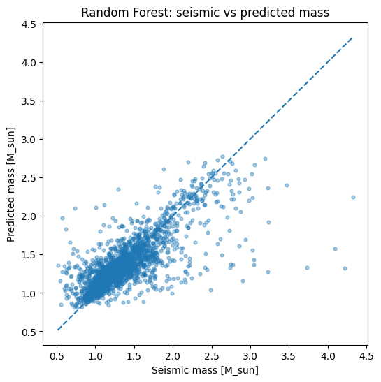
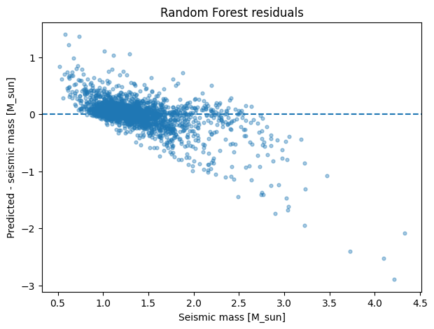
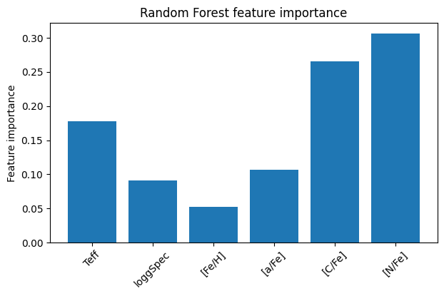
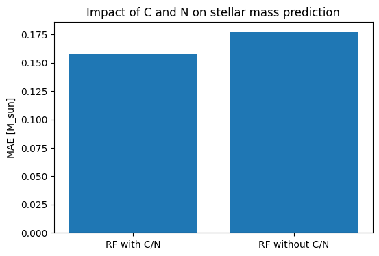
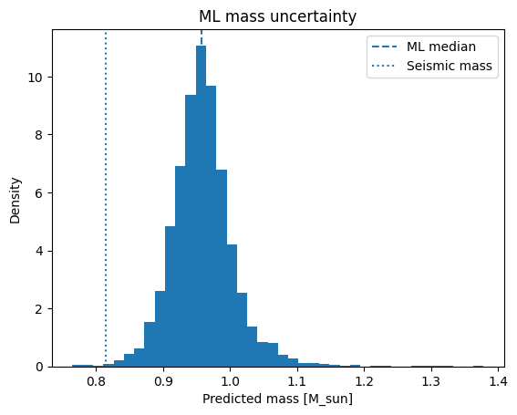
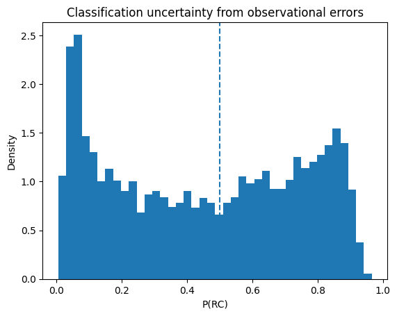

# Machine Learning Stellar Evolution from Surface Observables

A compact machine-learning study of evolved stars using APOKASC-3. The project asks two related questions:

1. **Can stellar mass be inferred from surface observables?**
2. **Can RGB and red-clump (RC) stars be separated from the same observables?**

The input features are:

- `Teff`
- `loggSpec`
- `[Fe/H]`
- `[a/Fe]`
- `[C/Fe]`
- `[N/Fe]`

The catalogue is downloaded directly from VizieR (`J/ApJS/276/69/table4`).

## Project structure

```text
stellar_evolution_ml_project/
├── stellar_ml_project.py
├── README.md
├── requirements.txt
└── figures/
    ├── 01_rf_seismic_vs_predicted.png
    ├── 02_rf_feature_importance.png
    ├── 03_cn_ablation_regression.png
    ├── 04_mass_uncertainty.png
    ├── 05_rf_residuals.png
    └── 06_classification_uncertainty.png
```

## Method

### 1. Stellar-mass regression

Two tree-based regressors are compared:

- Random Forest
- Gradient Boosting

Hyperparameters are selected using 5-fold cross-validation on the training set only. The held-out test set is used afterwards for final evaluation.

Current best Random Forest hyperparameters:

```python
{
    "n_estimators": 200,
    "max_depth": None,
    "min_samples_leaf": 4
}
```

Current best Gradient Boosting hyperparameters:

```python
{
    "n_estimators": 200,
    "learning_rate": 0.1,
    "max_depth": 3
}
```

### 2. C/N ablation experiment

The regression is repeated after removing `[C/Fe]` and `[N/Fe]`. This tests whether C and N contain predictive information beyond `Teff`, `loggSpec`, metallicity and alpha abundance.

### 3. RGB / RC classification

A multilayer perceptron is trained using only stars whose evolutionary labels have `EvolSrc = Seis`.

Architecture:

```text
6 inputs -> 16 neurons -> 8 neurons -> RGB / RC
```

The network uses standardization, L2 regularization and early stopping.

A second network is trained without C and N to perform the same ablation test as in the regression problem.

### 4. Uncertainty propagation

Two uncertainty experiments are included.

For stellar mass, bootstrap resampling is combined with Monte Carlo perturbations of:

- training-set observables,
- training-set masses,
- and the observables of a test star.

For RGB/RC classification, a star close to the decision boundary is perturbed 5000 times according to its observational errors, producing a distribution of network probabilities.

---

# Results

## Stellar-mass regression

| Model | Test MAE | Test RMSE | Test R² |
|---|---:|---:|---:|
| Random Forest | **0.1578 M_sun** | **0.2709 M_sun** | **0.5821** |
| Gradient Boosting | 0.1601 M_sun | 0.2742 M_sun | 0.5718 |

The Random Forest performs slightly better and is therefore used as the main regression model.



The residual plot reveals an important limitation: the model tends to **overestimate low masses and underestimate high masses**. The Random Forest therefore compresses the predicted mass range toward the densely populated part of the training distribution.



## Feature importance

The Random Forest importances from the current run are:

| Feature | Importance |
|---|---:|
| `Teff` | 0.178 |
| `loggSpec` | 0.091 |
| `[Fe/H]` | 0.053 |
| `[a/Fe]` | 0.107 |
| `[C/Fe]` | 0.266 |
| `[N/Fe]` | 0.306 |

C and N together account for about **57% of the total Random Forest importance**.



Feature importance is a measure of predictive use inside the Random Forest; it is **not evidence of causality**.

## Effect of removing C and N

| Regression model | MAE | RMSE | R² |
|---|---:|---:|---:|
| With C/N | **0.1578** | **0.2709** | **0.5821** |
| Without C/N | 0.1771 | 0.2889 | 0.5248 |

Removing C and N increases the test MAE by about **11%**. In this dataset, their surface abundances therefore contain additional predictive information about stellar mass beyond the other four observables.



This result is consistent with C/N carrying information related to stellar evolution and mixing, but the experiment alone does not establish a causal relationship between abundance and mass.

## Mass uncertainty example

For one low-mass test star, bootstrap + observational Monte Carlo gives:

```text
ML mass = 0.957 +0.039 / -0.039 M_sun
catalog/seismic mass = 0.815 +/- 0.032 M_sun
```



The intervals do not overlap. This is useful rather than problematic: it demonstrates that propagated statistical uncertainty does **not** automatically capture model bias. The disagreement is consistent with the low-mass overprediction seen in the residual diagram.

## RGB / RC classification

Final neural-network performance on the held-out test set:

```text
Accuracy = 0.9653
```

Confusion matrix, with rows = true class and columns = predicted class:

```text
          predicted RC   predicted RGB
true RC        907             44
true RGB        35           1292
```

The model therefore separates RGB and RC stars with approximately **96.5% accuracy**.

### Does C/N improve RGB / RC classification?

```text
With C/N accuracy    = 0.9653
Without C/N accuracy = 0.9662
```

The difference is negligible. This creates a useful contrast with the mass-regression result:

> **C and N materially improve mass inference, but add little measurable information for RGB/RC classification once Teff, logg, metallicity and alpha abundance are already known.**

This conclusion is specific to this catalogue, feature set and network architecture.

## Classification uncertainty

A test star close to the network decision boundary had nearly equal nominal RGB/RC probabilities. After perturbing its observables 5000 times according to their measurement errors:

```text
median P(RC) = 0.456
-0.368 / +0.348
fraction classified as RC = 0.468
```



Thus a model can have excellent global accuracy while individual objects close to its decision boundary remain highly uncertain.

`MLPClassifier.predict_proba` is treated here as a model confidence score under observational perturbations, not as a fully calibrated Bayesian posterior probability.

---

# Main conclusions

1. **Surface observables contain substantial information about evolved-star mass**, although the current Random Forest explains only part of the total variance (`R² ≈ 0.58`).
2. **Random Forest slightly outperforms Gradient Boosting** for this particular regression setup.
3. **C and N are especially informative for mass inference**: removing them worsens MAE by about 11%.
4. **The Random Forest has a clear mass-dependent systematic bias**, overpredicting low masses and underpredicting high masses.
5. **RGB and RC stars can be separated very effectively** from the chosen surface observables (`accuracy ≈ 96.5%`).
6. **Removing C and N barely changes RGB/RC accuracy**, so their main value in this experiment is mass inference rather than evolutionary-state classification.
7. **Observational uncertainty and model bias are different problems**. Monte Carlo propagation can quantify sensitivity to measurement errors while still missing systematic bias in the learned mapping.
8. **High global classification accuracy does not guarantee high confidence for every individual star**.

## Limitations and next steps

- Tree ensembles do not extrapolate well outside densely sampled regions of parameter space.
- The mass target is a catalogue-derived quantity with its own modelling assumptions and uncertainties.
- Feature importances can be affected by correlations between observables.
- Neural-network probabilities are not explicitly calibrated.
- Before claiming complete independence from asteroseismology, the calibration history of `loggSpec` should be checked for possible indirect seismic information.
- A future version could test calibrated probabilities, SHAP/permutation importance, and models designed explicitly for heteroscedastic uncertainties.

## Running the project

Install the dependencies:

```bash
pip install -r requirements.txt
```

Then run:

```bash
python stellar_ml_project.py
```

The script downloads the catalogue from VizieR and regenerates the figures in the `figures/` directory.
